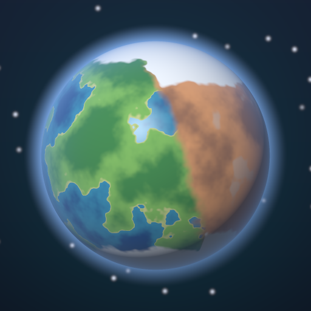
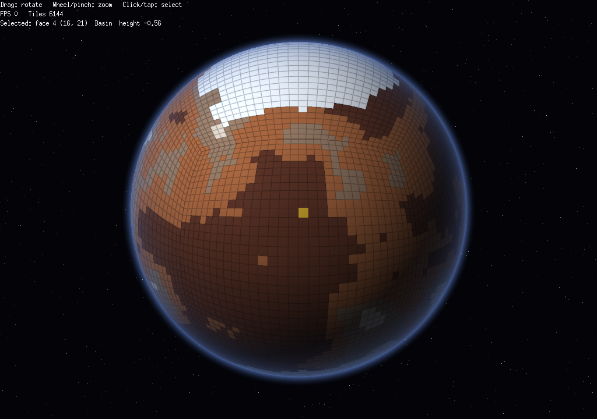
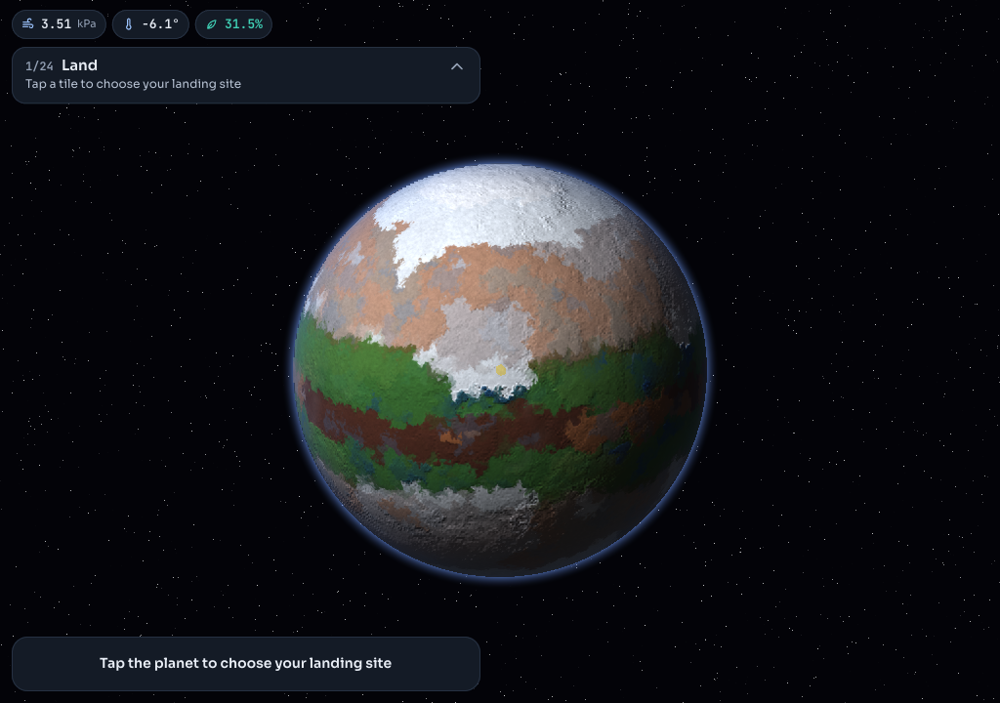
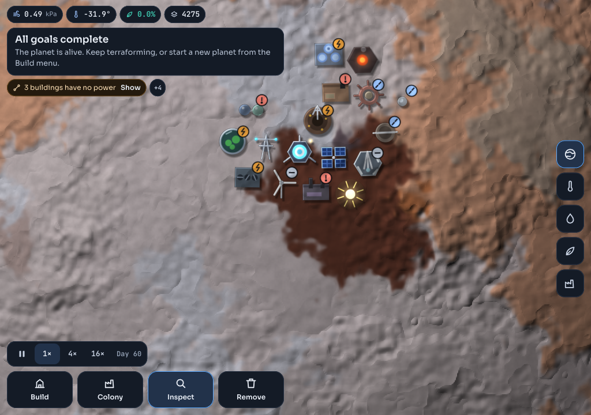
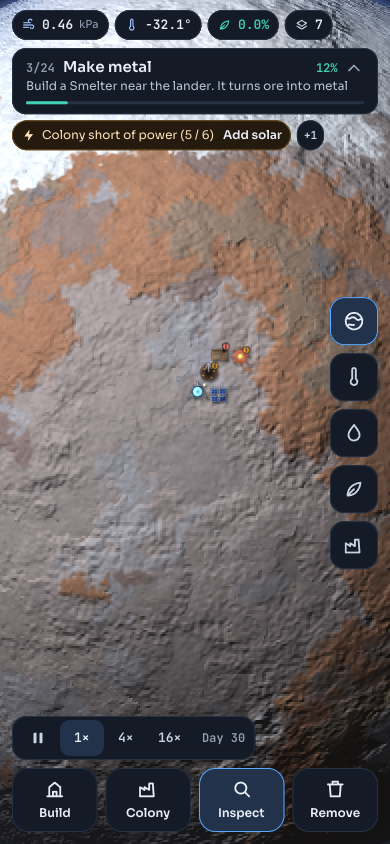
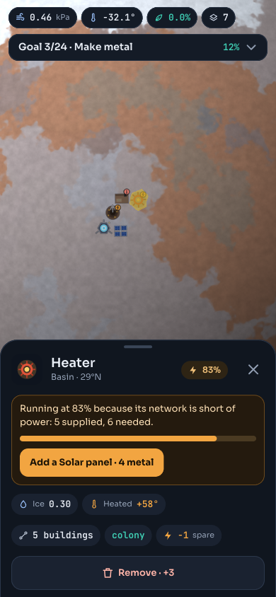
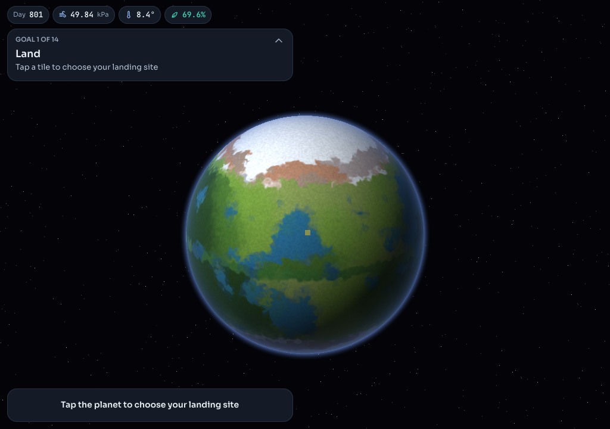

#  Terraformer

[](https://github.com/zachaller/terraformer/actions/workflows/ci.yml)

A mobile terraforming game in Go with [Ebitengine](https://ebitengine.org):
shape a barren planet until life takes hold. See
[docs/tech-stack.md](docs/tech-stack.md) for the design and technical plan.








## Download

The latest builds are on the
[Releases page](https://github.com/zachaller/terraformer/releases/latest):

| Platform | File | To run it |
|---|---|---|
| Android | `Terraformer-<version>.apk` | Open it on the phone and allow installing from your browser or file manager when asked |
| Mac (Apple silicon or Intel) | `-mac.zip` | Unzip, run `xattr -cr Terraformer.app` in Terminal (the app isn't signed by Apple), then open it |
| Windows | `-windows.zip` | Unzip and run `Terraformer.exe`; if SmartScreen warns, choose More info → Run anyway |
| Linux (x86-64) | `-linux.tar.gz` | `tar xzf` it and run `Terraformer/terraformer` |

Until the release signing key is set up, the Android build is a debug APK
(`-debug.apk`). The first properly signed APK won't install over it:
uninstall the debug one first, which deletes its save.

## Status: content and polish (roadmap steps 6 and 7)

- A procedurally generated planet covered in a geodesic hex grid (6,252
  tiles by default: hexagons plus the twelve pentagons a sphere needs),
  rendered as a 2D "shader globe": one screen quad and a Kage shader that
  ray-traces the sphere and looks each pixel up in a tile atlas. Tile colours
  are blended smoothly and broken up with noise, so the planet looks natural
  rather than like a ball of hexagons; a tile grid appears only around the
  tapped tile while a build or demolish tool is active.
- A climate and atmosphere simulation built on real terraforming ideas
  (mostly the ones proposed for Mars), with timescales compressed so a planet
  takes hours rather than centuries:
  - **Air made of gases**: CO₂, nitrogen, oxygen and factory-made
    super-greenhouse gases (PFCs), each tracked as a partial pressure. Warming
    comes from CO₂, PFCs, thicker air and water vapour (tap the pressure chip
    for the atmosphere sheet).
  - **Water that obeys its phase rules**: below 0.62 kPa (water's triple
    point) warmed ice turns straight to vapour, so liquid water first needs
    thicker air; the boiling point rises with pressure. Water evaporates,
    falls as rain or snow (mostly near where it rose), and flows downhill.
  - **CO₂ reservoirs**: polar caps of dry ice hold the air's CO₂ at the
    pressure where it would freeze at their temperature, and the ground holds
    more, released as it warms. Darken the caps or warm the planet enough and
    it tips into runaway warming.
  - **Albedo**: ice reflects sunlight, dark basins, water and plants absorb
    it, and dust darkens ice.
  - **Losing the air**: without a magnetic shield the solar wind slowly
    strips the atmosphere away.
  - **Life tied to the air**: microbes, then moss, grass, shrubs and forest on
    land (needing soil that earlier life builds, nitrogen, and an ozone layer
    that oxygen forms); plankton and fish in standing water; grazing animals
    once there's enough oxygen. Plants turn CO₂ into oxygen, and seas (and,
    late on, carbon scrubbers) lock CO₂ away, so late in the game the planet
    needs greenhouse gases to stay warm as CO₂ falls.
- A colony economy: choose a landing site, then build machines, connected by
  pylons.
  Deposits of iron, fluorite and nitrate, and volcanic tiles, are scattered
  over the planet; buildings unlock as goals are completed. Deposits show
  as crystal outcrops in their mineral's colour (gold iron, purple fluorite,
  pale green nitrate), and light up while you place a mine: tapping near
  one snaps to it, and **Nearest** steps through the free deposits, those
  the colony already reaches first. A mine works its whole patch (its own
  tile and the same mineral next to it), and when the patch is spent one
  tap moves it to the nearest free deposit.
- 24 goals that guide you from landing to air people could breathe, shown at
  the top of the screen with a hint and progress (tap the card for the full
  list): Land → Dig for ore → Make metal → Warm the ground → Above the triple
  point → Liquid water → First life → Spread life → Super greenhouse → Thicken
  the air → First moss → Release the caps → Thaw → A breath of oxygen → Seas →
  Nitrogen → Grasslands → Shield the air → Life in the seas → Forests →
  Oxygen-rich → Grazers → Living world → Breathable air. Completing one offers
  a Show me button. Expect 5–10 hours.
- Live alerts under the goal card for colony problems (no power, short of
  power, empty mines, starved or blocked buildings), each with a one-tap fix.
- A designed interface (see the [UX mocks](https://claude.ai/artifact/LMMKh2HSCZaoKDpbrFCqT3)):
  Sora and JetBrains Mono fonts (embedded; see `game/fonts/`), status chips,
  a goal card and goals list, alerts, a tool dock, a map-view rail, messages,
  an inspect panel (including what lives on a tile and what the next stage
  needs) and placement previews. Buildings are drawn in the shader with
  status badges (bolt: short of power; broken link: not connected;
  !: blocked; -: deposit empty).
- Sound, all synthesised in code (`game/audio.go`), that follows the
  planet: a thin hiss while there's hardly any air to carry sound, wind
  that deepens and gusts as the air thickens, a low drone on a barren
  world, rain once the air is humid and there's liquid water, surf on the
  seas, crickets once plants spread, birdsong once animals appear, warm
  chords as life takes hold, and the hum and clank of the colony when you
  zoom in on it. Effects differ by building category (power, industry,
  climate, air, projects) and all ring out with a little reverb. Switch it
  off from the Build menu.
- A first-time walkthrough of six short cards (turning the planet, landing,
  first mine and smelter, pylons, where to find things), waiting for the
  player where it asks them to do something. Skip ends it; it's only shown
  once (kept in `settings.json` beside the save).
- Automatic saving every 30 seconds, when the app goes into the background,
  and when the desktop window closes. **Tool → New planet** (tap twice)
  starts over on a fresh planet.

| Building | Cost (metal) | Unlocks after | Does |
|---|---|---|---|
| Lander | free, placed first | | Holds the colony stores; makes 3 power |
| Solar | 4 | | Makes 2 power |
| Pylon | 3 | | A hub: connects buildings within 4 tiles (load capacity 8), and other pylons and the lander within 12 |
| Wind turbine | 10 | Thicken the air | Up to 6 power, from 2 kPa, full at 40 kPa |
| Geothermal | 18 | First life | 10 power on a volcanic tile; warms it |
| Mine | 6 | | Digs a deposit and the patch of it around: iron ore, fluorite or nitrate; 1 power; pollutes |
| Smelter | 8 | | Turns 2 ore into 1 metal; 2 power; pollutes heavily |
| Ice drill | 10 | Warm the ground | Mines ice into water; 2 power |
| Heater | 6 | | About +30 °C on its tile, +19 °C on the ring around it, fading out; 3 power |
| Dust spreader | 12 | Warm the ground | Darkens ice up to 3 tiles around so it absorbs sunlight; 2 power |
| Greenhouse factory | 25 | Liquid water | Turns fluorite into PFCs, which warm the whole planet; 4 power |
| Orbital mirror | 150 | Thicken the air | +45 °C of focused sunlight, fading over 4 tiles; no power |
| Electrolyser | 20 | Liquid water | Splits water into oxygen; 4 power |
| Nitrogen plant | 20 | First moss | Turns nitrate into nitrogen; 3 power |
| Magnetic shield | 400 | Thaw | Stops the air escaping to space; 20 power; one only |
| Carbon scrubber | 35 | Oxygen-rich | Captures CO₂ from the air and locks it away; 6 power |
| Biolab | 30 | First life | Life takes hold far faster up to 3 tiles around; 3 power |
| Comet | 120 | Thaw | Strikes 30 days after it's aimed: water, nitrogen and CO₂, a crater, and destruction 2 tiles around; one at a time |

Buildings join networks through hubs: the lander and pylons connect
buildings within 4 tiles, and hubs within 12 tiles of each other connect,
so a chain of pylons carries the colony's network across the planet. Each
hub has a load capacity (pylons 8, the lander 12), and each building it
connects takes load by its distance (1 next door, up to 4 at the edge), the
nearest first: dense or spread-out colonies need more pylons, and a
building no hub has room for stays unconnected. There are no manual links,
and connections aren't drawn: the placement preview says what will connect
a building, and status badges show what isn't. A network shares its power
(short of power, everything in it slows down) and moves resources between
buildings. Networks that include the lander send surplus
into the colony stores, which pay for construction, and feed machines from
them. A network doesn't have to reach the colony: a pylon, a dust spreader
and a solar panel make a working outpost on a polar cap. Pollution from
mines, smelters and
factories stops life growing nearby, so where you put industry matters.
Buildings that are idle (unpowered, out of input, or with a full output
buffer) pulse red.

### Controls

The bottom bar holds the tools; the column of buttons on the right switches
map view; the pill above the bar sets the speed. Tap the goal card to
collapse it. With **Inspect**, tapping a tile opens a panel that explains it:
why a building isn't at full speed (with a one-tap fix), whether microbes can
live there and what's stopping them, and the building's network.

| Action | Touch | Desktop |
|---|---|---|
| Rotate | Drag | Drag with left mouse button |
| Zoom | Pinch | Mouse wheel |
| Use the current tool on a tile | Tap | Click |
| Build menu (by category: Power, Industry, Climate, Air, Projects; and new planet) | **Build** | `B`, or `1`–`4` for Solar, Mine, Smelter, Heater |
| Place a building: tap a tile to preview it (heat or pollution area, effects, warnings), tap another to move it, then **Build here** | Tap, then **Build here** | Click, then `Enter` |
| Inspect a tile or building | **Inspect**, then tap it | `I` |
| Colony overview: resources in stock and made per day, power, buildings by type (tap a "held up" count to see one) | **Colony**, or tap the metal, power or resource chips | |
| Remove a building (half its metal back) | **Remove** | `X` |
| Map view (Surface / Temperature / Water / Life / Industry) | Right-hand buttons | `V` |
| Speed (Paused / 1× / 4× / 16×), and the day | Speed pill | `Space` pause, `F` fastest |
| Atmosphere details | Tap the kPa chip at the top (one row: pressure, temperature, life, metal) | |
| Collapse the goal card | Tap it | `G` |
| Close panels, cancel a placement | Close button | `Esc` |

## Running on desktop

Needs Go 1.25+. On Linux, also install Ebitengine's system dependencies:

```sh
sudo apt install libc6-dev libgl1-mesa-dev libxcursor-dev libxi-dev \
  libxinerama-dev libxrandr-dev libxxf86vm-dev libasound2-dev pkg-config
```

macOS and Windows need nothing extra. Then:

```sh
go run ./cmd/desktop                 # default planet
go run ./cmd/desktop -seed 7 -size 64
```

| Flag | Default | Meaning |
|---|---|---|
| `-seed` | 1 | Seed for a new planet (ignored when continuing a save); the same seed always gives the same planet |
| `-no-audio` | false | Turn sound off (automatic on Linux machines with no sound device) |
| `-no-save` | false | Don't load or save the game (saves live in your user config directory under `terraformer/`) |
| `-size` | 25 | Hex grid size: steps along each icosahedron edge (total tiles = 10 × size² + 2) |
| `-view` | surface | Starting view: `surface`, `temp`, `water`, `life` or `industry` |
| `-zoom` | 1 | Starting zoom |
| `-demo-colony` | false | Land and build a small working colony facing the camera |
| `-demo-showcase` | false | With `-demo-colony`, also build one of every other building |
| `-demo-heaters` | false | Put fixed warmth on a ring of tiles around the equator and a little greenhouse gas in the air: enough to tip the planet into runaway warming |
| `-demo-steps` | 0 | Fast-forward this many steps before starting (10 steps = 1 day) |
| `-width`, `-height` | 1024, 720 | Window size |
| `-safe-area` | | Simulate phone system bars: `left,top,right,bottom` insets in pixels |
| `-screenshot` | | Save a PNG of the first frames to this path and exit |

Headless screenshot (e.g. on a server):
`xvfb-run -a go run ./cmd/desktop -screenshot shot.png`

## Running on Android

Build a debug APK (signed with a debug key, for sideloading):

```sh
export ANDROID_HOME=/path/to/android-sdk            # platform 36, build-tools
export ANDROID_NDK_HOME=$ANDROID_HOME/ndk/<version>
go install github.com/hajimehoshi/ebiten/v2/cmd/ebitenmobile@v2.10.5
scripts/build-android.sh
```

The script binds the Go game into `android/app/libs/terraformer.aar` with
`ebitenmobile`, then runs Gradle. The APK lands in
`android/app/build/outputs/apk/debug/app-debug.apk`. With a phone connected
over USB (developer options and USB debugging on):
`adb install -r android/app/build/outputs/apk/debug/app-debug.apk`

A signed release APK and Play Store bundle (AAB) come from
`scripts/build-android.sh release`, with the upload keystore given by
`TERRAFORMER_KEYSTORE`, `TERRAFORMER_KEYSTORE_PASSWORD`,
`TERRAFORMER_KEY_ALIAS` and `TERRAFORMER_KEY_PASSWORD`.

## Desktop packages

`scripts/build-desktop.sh` builds `dist/Terraformer-<version>-mac.zip` (a
universal Apple silicon and Intel `.app`), `-windows.zip` and, on Linux,
`-linux.tar.gz`. The Mac and Windows builds cross-compile from any OS. The
Mac app isn't signed, so after unzipping run `xattr -cr Terraformer.app`
before opening it the first time.

## Releases

GitHub Actions does it (`.github/workflows/`):

- **CI** runs on every push and pull request: gofmt, `go vet`, all the
  tests (including the playthrough), and the desktop and Android builds,
  kept as downloadable artifacts for a week.
- **Release** publishes a GitHub release with the Mac, Windows and Linux
  packages and the Android APK (and AAB), with notes made from the commits
  since the last release. It runs the same build first.

To cut a release, set `versionName` (and bump `versionCode`) in
`android/app/build.gradle` and merge it to `main`. Then either open the
Actions tab, pick **Release** and press **Run workflow** on `main` (it tags
the commit `v<versionName>` itself), or push the tag yourself:

```sh
git tag v0.14.0 && git push origin v0.14.0
```

A pushed tag must match `versionName`, and a version that's already been
released is refused. A version with a hyphen (`0.15.0-beta1`) is published
as a pre-release.

Android releases are signed with the upload key from these repository
secrets (Settings → Secrets and variables → Actions). Without them the
release gets a debug APK and no AAB.

| Secret | Value |
|---|---|
| `ANDROID_KEYSTORE_BASE64` | the keystore file, base64-encoded (`base64 -w0 upload.jks`) |
| `ANDROID_KEYSTORE_PASSWORD` | the keystore's password |
| `ANDROID_KEY_ALIAS` | the key's alias, e.g. `upload` |
| `ANDROID_KEY_PASSWORD` | the key's password |

Make the keystore once, and keep it (and its passwords) safe; every Play
Store update must be signed with the same key:

```sh
keytool -genkeypair -v -keystore upload.jks -alias upload \
  -keyalg RSA -keysize 2048 -validity 10000
```

## Tests

```sh
go test ./...          # includes a bot playthrough of every goal (several minutes)
go test -short ./...   # skips it
go test ./sim -run Playthrough -v   # shows the bot's pacing
```

## Layout

```
sim/          pure Go simulation: grid, planet generation, climate/water/life rules, buildings and networks (no engine imports)
game/         Ebitengine front end: camera, input, planet shader, views, UI (ui.go, inspect.go, draw.go, text.go), fonts
cmd/desktop/  desktop entry point
mobile/       Android entry point, bound by ebitenmobile
android/      thin Android project (one Activity hosting the game view)
cmd/icon/     draws the app icon for every platform (go run ./cmd/icon)
scripts/      build and packaging scripts
.github/      CI and release workflows
docs/         design and technical docs
```
